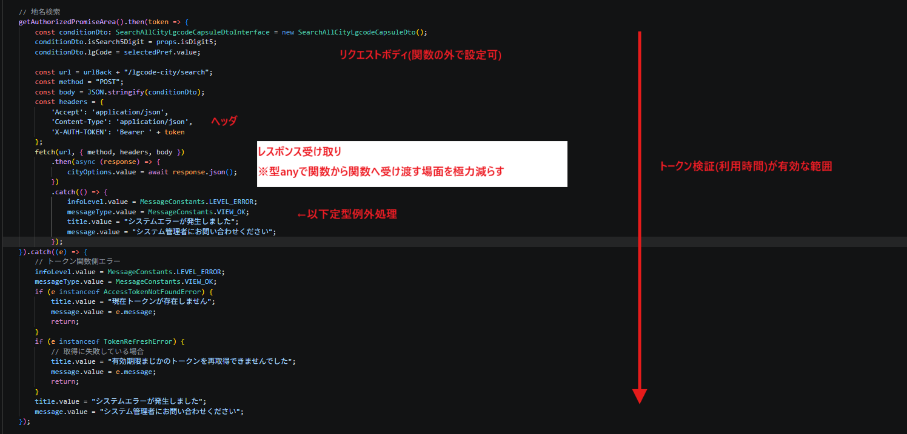

# トークン取得共通関数: getAuthorizedPromiseArea()

## 1. 概要

- アプリケーション全体および他サブドメイン・外部フロントエンドで共通して使用される、API実行用の認証トークン（JWTアクセストークン）を非同期で取得する共通関数です。
- 保存されているトークンの有効期限（直前2分前）を検証し、必要に応じてバックエンドの `/refresh-token` API を通じて自動的にトークンの再取得・更新を行います。
- **リフレッシュトークン・ローテーション（RefreshToken Rotation）** に完全対応しており、リフレッシュ成功時に新しいアクセストークンと新しいリフレッシュトークンの両方をストア（`userInfo.jwtDto`）に安全に反映・保持します。
- **排他制御（In-flight Promise deduplication）** を内蔵しており、複数のコンポーネントから同時に呼び出された場合でも、リフレッシュAPIのリクエストは1度しか送信されず、安全に結果が共有されます（古いリフレッシュトークンの重複送信による失効エラーを完全に防止）。
- APIユーザ（外部システム）が長期トークンを基にアクセスを行う場合、最初のAPIアクセスの前に一度発行された長期トークンをユーザ情報に登録することで、自動的にアクセストークンが取得・維持されます。

---

## 2. 処理内容と戻り値

### `getAuthorizedPromiseArea(): Promise<string>`

- **戻り値**: `Promise<string>`
- 認証トークンの取得に成功した場合、解決（resolve）されたPromiseから有効なJWTアクセストークン文字列が返却されます。

### 提供される関連ユーティリティ

- **`createAuthorizedHeaders(token: string, additionalHeaders?: HeadersInit): Record<string, string>`**:
  - `X-AUTH-TOKEN: Bearer <token>` や `Content-Type: application/json` などのクロスドメイン通信に必要な認証ヘッダーを自動生成・マージします。
- **`fetchWithAuth(input: RequestInfo | URL, init?: RequestInit): Promise<Response>`**:
  - トークンの検証・自動リフレッシュから `X-AUTH-TOKEN` ヘッダー付与、`fetch` API の実行までを一括で行う高水準ヘルパー関数です。

---

## 3. 例外処理・エラーハンドリング

トークン取得時にエラーが発生した場合、以下の例外（Error）クラスがスローされます。

| 例外クラス | 発生契機 | エラーメッセージ例 | 対処方法 |
| --- | --- | --- | --- |
| **`AccessTokenNotFoundError`** | ストレージにアクセストークンが存在しない | 「アクセストークンが見つかりません。」 | ログイン画面へ遷移するか、長期トークンを設定する |
| **`TokenRefreshError`** | トークンの有効期限切れ、リフレッシュAPI失敗、401/403失効 | 「認証セッションが失効しました。再度ログインしてください。」「トークンのリフレッシュに失敗しました。(HTTP 500)」 | 再ログインを促すか、エラー通知を表示する |
| **`PasskeyAuthenticationError`** | パスキー2FA認証時の署名検証失敗 | 「パスキー認証に失敗しました。」 | パスキー操作の再試行または別端末での認証 |
| **`PasskeyNotSupportedError`** | ブラウザ/端末がWebAuthn非対応 | 「お使いのブラウザまたは端末はパスキー認証に対応していません。」 | パスワード認証のみ、または対応ブラウザの利用を案内 |
| **`PasskeyCancellationError`** | ユーザーによる生体認証キャンセル | 「パスキー認証操作がキャンセルされました。」 | 認証操作の中断・再試行 |
| **`PreAuthTokenExpiredError`** | 2FA用の一時トークン有効期限切れ | 「一時認証トークンの有効期限が切れています。最初からログインし直してください。」 | ログイン画面に戻りID/PWから再認証 |

---

## 4. 利用例

### パターンA: `fetchWithAuth` を使用した推奨の簡潔なアクセス

```typescript
import { fetchWithAuth, TokenRefreshError, AccessTokenNotFoundError } from 'seijishikin-jp-normalize_common-tool';

async function loadPrefectureData() {
    try {
        const response = await fetchWithAuth(RoutePathConstants.DOMAIN + '/lgcode-pref/search', {
            method: 'POST',
            body: JSON.stringify({ isDigit5: false }),
        });
        const data = await response.json();
        console.log('取得成功:', data);
    } catch (e) {
        if (e instanceof AccessTokenNotFoundError || e instanceof TokenRefreshError) {
            // 認証失効・未ログイン時の処理（ログイン画面へリダイレクトなど）
            console.error('認証エラー:', e.message);
            return;
        }
        console.error('通信エラー:', e);
    }
}
```

### パターンB: `getAuthorizedPromiseArea()` と `createAuthorizedHeaders()` を使用したアクセス

```typescript
import {
    getAuthorizedPromiseArea,
    createAuthorizedHeaders,
    TokenRefreshError,
    AccessTokenNotFoundError,
    useUserInfoStoreCommon,
} from 'seijishikin-jp-normalize_common-tool';

// 外部ドメイン/別サイトからの初回アクセス時: 発行された長期トークンをセット
const userInfo = useUserInfoStoreCommon();
userInfo.jwtDto.refreshToken = mySavedLongToken;
userInfo.jwtDto.accessToken = ""; // 空文字にすると長期トークンからアクセストークンを取得する

// APIアクセス
getAuthorizedPromiseArea()
    .then(token => {
        const url = RoutePathConstants.DOMAIN + '/lgcode-city/search';
        const headers = createAuthorizedHeaders(token);
        const body = JSON.stringify({ lgCode: '130001', isSearch5Digit: false });

        return fetch(url, { method: 'POST', headers, body });
    })
    .then(async response => {
        if (!response.ok) {
            throw new Error(`HTTP error: ${response.status}`);
        }
        const cities = await response.json();
        console.log('市区町村一覧:', cities);
    })
    .catch(e => {
        if (e instanceof AccessTokenNotFoundError) {
            alert('ログインが必要です: ' + e.message);
            return;
        }
        if (e instanceof TokenRefreshError) {
            alert('セッションが切れました: ' + e.message);
            return;
        }
        alert('システムエラーが発生しました');
    });
```

---

## 5. クロスドメイン・サブドメイン運用ガイドライン

### 5.1 同一親ドメインの別サブドメインからの通信 (`*.example.com` -> `api.example.com`)

1. **RP ID境界**:
   - WebAuthnの Relying Party ID は親ドメイン（例: `example.com`）に設定されているため、サブドメインを跨いでパスキー認証の同一性が維持されます。
2. **CORS設定**:
   - バックエンドの `application.yml` において `app.cors.allowed-origin-patterns: https://*.example.com` が設定されていることを確認してください。
3. **認証ヘッダー**:
   - `X-AUTH-TOKEN: Bearer <token>` を送信します。バックエンド側のCORS設定で `ExposedHeaders` に `X-AUTH-TOKEN` が含まれているため、レスポンスヘッダーの読み取りも許可されます。

### 5.2 完全別ドメイン（APIパートナー外部サイト）からの通信

1. **WebAuthn仕様上の制約**:
   - ドメインが完全に異なる場合、ブラウザのセキュリティ仕様により別ドメイン上のパスキーを直接読み出すことはできません。
2. **長期トークン＋APIリレー運用**:
   - 事前に本サービス管理画面で発行された「APIパートナー長期トークン」を外部サイト側で安全に保持します。
   - 初回APIアクセス前に `userInfo.jwtDto.refreshToken`  に長期トークンをセットし`accessToken`に空をセットすることで、`getAuthorizedPromiseArea()` が(次回個別業務APIアクセス時に)自動的に一時アクセストークン（JWT）を発行・更新します。
   - バックエンド側では、該当パートナーのIPアドレス制限（CIDR対応）およびレートリミット（Bucket4j）により不正アクセスが二重に防止されます。


